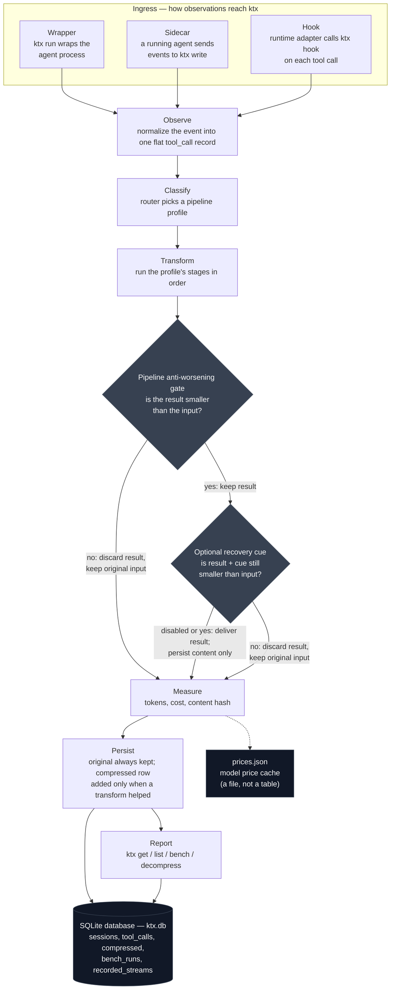
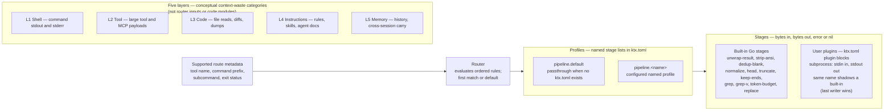

# ktx Architecture

Conceptual architecture for ktx. This document describes **what the system is for**, **how its parts relate**, and the unresolved architectural questions. It is not an executable work backlog. Actionable work and deliberation tasks live in [`TODO.md`](TODO.md).

For product direction, see `.agentera/vision.yaml`. For recorded choices already made in deliberation, see `.agentera/decisions.yaml`. For agent workflow and document maintenance, see `AGENTS.md`.

---

## Purpose

ktx is a single, runtime-agnostic command-line layer that coding agents can adopt without importing a library or running a background service. It exists to make agent work **measurable** and **cheaper**: every meaningful interaction leaves evidence, and compression reduces what reaches the model without hiding the cost of doing so.

The architecture serves two audiences at once:

- **The agent runtime** — transparent interception, minimal friction, predictable behavior.
- **The agent-native developer** — inspectable records, reversible compression, and a benchmark number that can be cited and disputed.

Compression is the demonstrator. Measurement is the contract. The benchmark is the headline.

---

## Architectural goals

| Goal                                  | Meaning                                                                                                            |
| ------------------------------------- | ------------------------------------------------------------------------------------------------------------------ |
| **Invisible until needed**            | Normal agent workflows proceed unchanged; value appears in summaries, queries, and benchmarks—not in ceremony.     |
| **Evidence over claims**              | Savings and cost are derived from stored observations, not from marketing or one-off demos.                        |
| **Reversibility before aggression**   | Compression may be strong only where originals can be recovered on demand.                                         |
| **Stable surface, evolving dispatch** | The user-facing CLI stays boring and stable; what happens behind the router can improve without breaking adoption. |
| **One artifact**                      | A single binary the runtime invokes—no daemon requirement, no library coupling.                                    |

---

## Conceptual system

At the highest level, ktx is a loop:

```text
observe → classify → transform → measure → persist → report
```

Every adoption path feeds this same loop. An observation (one tool call and its output) enters at the top; evidence comes out at the bottom:



Two steps in the loop have internal structure worth seeing on their own. Classify and transform work like this:



### Grammar

The diagrams above use five nouns that build on each other. In order from outermost to innermost:

| Term        | What it is                                                                                                                                                                                                                                                                                                                                                                       | Examples                                                                                                                                                          | Where it lives                                                                               |
| ----------- | -------------------------------------------------------------------------------------------------------------------------------------------------------------------------------------------------------------------------------------------------------------------------------------------------------------------------------------------------------------------------------- | ----------------------------------------------------------------------------------------------------------------------------------------------------------------- | -------------------------------------------------------------------------------------------- |
| **Ingress** | An adoption mode: how ktx receives observations from an agent. Ingress variants converge on the same internal loop; the choice only changes _where_ observation begins.                                                                                                                                                                                                          | Wrapper (`ktx run`), Sidecar (`ktx write`), Hooks (`ktx init <runtime>` adapters delegating to `ktx hook`)                                                        | Agent runtime + ktx CLI                                                                      |
| **Layer**   | A category of agent context where waste appears. Layers describe problem domains, not router inputs, profile names, or separate code modules.                                                                                                                                                                                                                                    | L1 Shell (command output), L2 Tool (MCP payloads), L3 Code (file reads, diffs), L4 Instructions (rules, skills), L5 Session+memory (history, cross-session carry) | Conceptual taxonomy only; no layer field exists in the record today                          |
| **Profile** | A named, ordered list of stage tokens that the runner executes. Profiles are selected by ordered configured routes over tool name, command prefix, subcommand, and exit status; the first matching route wins and otherwise `default` runs. Content shape and conceptual layers do not select or imply profiles.                                                                 | `[pipeline.default] stages = ["strip-ansi", "head:100"]`                                                                                                          | `ktx.toml` `[pipeline.<name>].stages`; inspectable via `ktx config show --json`              |
| **Stage**   | A single bytes-in → bytes-out → error-or-nil transform. Stages are the atoms a profile is built from. The runner enforces the conservative-on-failure contract around every stage; stage authors cannot violate it. Built-in Go stages and external subprocess stages share the same `Stage` interface.                                                                          | `strip-ansi` (no arg), `head:100` (arg = line count), `token-budget:2000`, `grep:^error:`                                                                         | Go package `internal/pipeline/stages`; also any command addressable via a `[[plugin]]` block |
| **Plugin**  | A user-registered external stage: a shell command ktx spawns with input on stdin and output on stdout. Plugins are registered after built-ins, so a plugin named `head` shadows the built-in `head` (last-writer-wins); removing the block restores the built-in. A plugin is just another stage from the runner's perspective — the only difference is _how it got registered_. | `[[plugin]] name="myf", command="/usr/local/bin/myf", description="custom filter"`                                                                                | `ktx.toml` `[[plugin]]` blocks; managed via `ktx plugin add/list/remove`                     |

**How they relate:** An **ingress** path delivers a tool_call to ktx. The router evaluates configured metadata rules and picks a **profile**. The conceptual **layer** taxonomy describes where context waste occurs but does not drive that selection. The profile is an ordered list of **stage** tokens; each stage (built-in or **plugin**) transforms bytes. The pipeline result passes the anti-worsening gate, then is measured and persisted. None of these nouns know about each other's internals — ingress is layer-agnostic, layers are not a code module, profiles name stages by token, and plugins are just stages registered from ktx.toml.

**Observe** — Capture what the agent (or its tools) produced: command output, tool payloads, file reads, static instructions, session history.

**Classify** — Select a configured profile from supported tool-call metadata, preserving the default when no route matches. The router wins; individual algorithms are interchangeable behind it.

**Transform** — Apply compression through built-in behavior, user configuration, or both. Whether memory-oriented distillation belongs in this loop is not yet specified; see [Layer 5 boundary](#layer-5-boundary). Failure is conservative: a stage that errors, produces empty output from non-empty input, or is unknown passes its input through unchanged. After all stages run, the anti-worsening gate discards the whole result unless it is smaller than the input. A lossy hook profile may then add a configured recovery cue; a second gate suppresses the transform unless the result and cue together remain smaller than the original.

**Measure** — Attach quantitative evidence: tokens in, tokens out, cost, integrity fingerprints. Numbers, not adjectives.

**Persist** — Write per-interaction and per-session evidence; records are queryable later via the database. Originals are append-only and never deleted; compressed artifacts are separate rows that point back to their source by id.

**Report** — Surface run summaries, inspection queries, and aggregated benchmark results—including the headline number that proves savings.

The loop is the system; adoption mode only changes _where_ observation begins.

Default database file: `$XDG_DATA_HOME/ktx/ktx.db`. Normal commands select an alternate database through `KTX_DB`. Within the `ktx db` namespace, the per-invocation `--path <file>` flag takes precedence over `KTX_DB` (Decision 8 revised).

---

## Integration topology

Agents differ in how they can host external tooling. ktx accommodates multiple adoption paths that converge on the same internal loop and the same database:

| Mode        | Role                                                                                                                                                                              |
| ----------- | --------------------------------------------------------------------------------------------------------------------------------------------------------------------------------- |
| **Wrapper** | ktx launches or wraps the agent process; observation starts at invocation. Suited to non-interactive and pipe-friendly workflows. Agent output to the caller remains transparent. |
| **Sidecar** | An already-running agent sends events to ktx; observation starts when data arrives. Suited to richer runtimes and custom integrations.                                            |
| **Hooks**   | ktx is wired into the agent's configuration; observation runs silently inside long-lived sessions (including TUIs). Suited where wrapping the process is impractical.             |

Tool-call records use KTX-owned persisted identifiers. Runtime identifiers are
correlation inputs, not database identities. Deterministic identity is eligible
only when a recognized, trusted native ingress verifies a complete usable
runtime/session/call tuple. The OpenCode hook and wrapper and the Codex
PostToolUse hook meet that provenance boundary; caller-supplied runtime text in
generic sidecar or flat input does not. Eligible tuples derive the same source
ID across process, machine, hook, and wrapper boundaries. Missing, malformed,
or unverified tuples receive a fresh NanoID with no deduplication guarantee.
That fallback applies when a payload selects a recognized adapter path, such as
OpenCode, but lacks its complete native tuple; a caller ID cannot substitute for
the tuple. Legacy flat ingress without a recognized runtime-adapter
discriminator remains compatible by preserving a caller-supplied ID, or
generating a fresh ID when none is supplied.

Native correlation is separate from KTX session ownership: the first accepted
delivery owns the source row's KTX session association, and an exact retry
through another KTX session does not move it or increment another roll-up.
Exact eligible retries compare runtime, tool, canonical input evidence, and
output bytes. Equal evidence converges on one source row; later metadata does
not enrich it. The first compressed artifact is authoritative once persisted,
and pipeline changes cannot replace it. A concurrent exact retry may receive
source output if it checks before any artifact exists; retries after persistence
return the first artifact. Changed authoritative evidence is a conflict and
leaves the first evidence unchanged. Historical random-ID rows and new
deterministic rows coexist without migration, aliases, or reconstructed runtime
identifiers.

Architecturally, these are **ingress variants**, not separate products. Inspection, compression, reversibility, and benchmarking must not depend on which path recorded the data.

---

## The five compression layers

Context waste appears at different stages of an agent session. ktx aims to address all of them through one dispatch model—not five separate tools.

| Layer                | What it targets                                      | Architectural intent                                                                                                  |
| -------------------- | ---------------------------------------------------- | --------------------------------------------------------------------------------------------------------------------- |
| **1 — Shell**        | Command-line stdout and stderr                       | Filter noise before tool results enter context. Highest volume, lowest semantic risk when done conservatively.        |
| **2 — Tool**         | Large structured tool and MCP payloads               | Compact or sandbox bulky results; retrieve detail only when the agent asks.                                           |
| **3 — Code**         | File reads, diffs, exploration dumps                 | Prefer outlines and targeted excerpts over full-file dumps.                                                           |
| **4 — Instructions** | Always-on project memory (rules, skills, agent docs) | Shrink static context loaded every session without dropping safety-critical constraints.                              |
| **5 — Memory**       | Conversation history and cross-session carry         | Its boundary, lifecycle, and distillation mechanism are not yet specified; see [Layer 5 boundary](#layer-5-boundary). |

Layers organize the problem space rather than defining separate binaries, long-running services, or automatic **pipeline profile** mappings. Operators map supported tool-call metadata to named profiles through ordered route configuration; unmatched calls use the default profile.

Layer 5 names the cross-turn and cross-session context problem. Whether and how ktx addresses it is not yet specified; see [Layer 5 boundary](#layer-5-boundary).

---

## Core components (conceptual)

These are logical roles, not implementation modules. Names may change as deliberation proceeds.

### Ingress

Accepts observations from wrapper, sidecar, or hook paths. Normalizes them into a common internal representation before classification.

### Router

Inspects incoming bytes (or metadata about them) and selects a pipeline profile. This is the deliberate center of gravity: ktx optimizes for **correct dispatch**, not for owning the best compression algorithm in every category.

### Pipeline

Executes an ordered sequence of transformation stages—built-in, configured, or external—producing compressed output and failure semantics when a stage cannot run safely.

### Reversibility

Retains originals keyed for retrieval on demand. Lossy hook profiles may append an agent-visible recovery cue containing the canonical source ID and `ktx read <source-id>`. Recovery cues are configuration-controlled and emitted only when the compressed result plus the cue remains smaller than the original. The persisted compressed artifact remains content-only.

### Persistence

Writes session-scoped and call-scoped records to the database: inputs, outputs, metrics, and references into the reversibility layer. Exposed as mechanical I/O (`read` / `write`) and higher-level query (`get` / `list`).

### Measurement

Ingests telemetry only from the agent runtime without rewriting it. Provider and model identity may be emitted by the runtime or inferred from explicit runtime configuration, with provenance. Reported cost, including literal zero, remains runtime evidence. Provider documentation and pricing catalogs remain semantic/reference/estimate sources, not telemetry. A separate nullable API-equivalent estimate is reconstructed from cache-aware models.dev prices for uncached input, cache reads, cache writes, output, and reasoning. Benchmark experiments retain the exact resolved pricing record so estimates can be regenerated without consulting mutable live data. Historical direct-provider fixtures may remain for offline compatibility and provenance, clearly labeled unsupported for current collection. Aggregate runtime tokens, labels, configured identity, and historical fixtures never establish provider-internal cache hits, misses, fills, eviction, request boundaries, isolation, or prefix composition.

### Benchmark

Aggregates persisted evidence into comparable headline metrics—reported cost per correct answer, estimated API cost per correct answer, savings over baseline, and related reports—using a published methodology. New evidence summaries use deterministic descriptive distributions, pair baseline and candidate attempts by execution cycle, and annotate rather than remove outliers; they do not make inferential significance claims. Cache-aware comparisons retain cold observation and warm-up evidence separately from measured-warm headline attempts. Comparisons vary runtime, model, and provider configurations while collecting only runtime observations and identity provenance; they remain observed-only and make no provider-internal hit, miss, fill, request-boundary, isolation, or prefix-composition claim. Rebuild penalties and cumulative break-even use the retained API-cost estimates. The Go experiment module owns tasks, scoring, retained manifests and attempts, retained pricing snapshots, deterministic summaries, live comparison, and ranking. SQLite remains product evidence; experiment-side assignment, cache-control metadata, and orchestration metadata remain file artifacts outside the database.

### Extension registry

A discoverable set of user-supplied behaviors that pipelines can invoke. Distinct from hook installation (which wires ktx into an agent runtime) and from persistence (which holds evidence).

---

## I/O and query separation

Architecturally, ktx distinguishes **mechanical I/O** from **derived inspection**:

- **I/O** (`read`, `write`) moves records faithfully—raw, structured, suitable for pipelines and audits. Always raw JSON; no output-format flag.
- **Query** (`get`, `list`, `db report`, `bench`) aggregates, filters, and formats for humans or downstream tools. JSON by default; `--format text` for humans.

Compression produces new records from existing ones; decompression recovers prior bytes through the public surface. Benchmark reads from the same evidence as inspection: no parallel truth.

---

## Quality attributes

| Attribute                | Target behavior                                                                                                                                                       |
| ------------------------ | --------------------------------------------------------------------------------------------------------------------------------------------------------------------- |
| **Transparency**         | Wrapped agents behave like unwrapped agents from the caller's perspective; side effects of measurement stay out of the agent's primary I/O where silence is required. |
| **Conservative failure** | When compression cannot run safely, pass through unchanged and record that fact—never substitute guessed content.                                                     |
| **Empirical default**    | Machine-readable output is the default; human-readable views are opt-in. Exit codes encode outcome class.                                                             |
| **Local-first**          | Evidence and reversibility material remain under the developer's control on disk; no required cloud account for core operation.                                       |
| **Boring extension**     | Prefer universal, inspectable extension mechanisms over embedded domain-specific languages or opaque magic.                                                           |

---

## Resolved tension (intentional)

ktx will not win every compression benchmark against specialized tools. It wins by **dispatching** the right strategy per layer, **recording** what happened, and **proving** savings and cost in a form others can cite.

The CLI surface stays narrow. The space behind the router stays wide.

---

## Open deliberations

These questions do not select an implementation. Each has one executable deliberation task in [`TODO.md`](TODO.md#architectural-deliberations). When a choice is recorded, follow [AGENTS.md — Documentation maintenance](AGENTS.md#documentation-maintenance).

### Evidence maintenance boundary

Given that originals are append-only and retained, the first compressed artifact and retry evidence remain authoritative, and `ktx doctor` is read-only, which non-authoritative derived, index, or orchestration artifacts may be compacted, reconciled, or pruned? If maintenance is permitted, what explicit command boundary keeps mutation outside `ktx doctor`?

→ [Deliberation task](TODO.md#deliberate-evidence-maintenance-boundary)

### Pipeline stage semantics

What stage metadata, ordering guarantees, and terminal-versus-continuable semantics are needed beyond the established bytes-in, bytes-out, error-or-nil runner contract?

→ [Deliberation task](TODO.md#deliberate-pipeline-stage-semantics)

### Universal preprocessing and filter-pack composition

Should universal preprocessing exist, and if so, how should it compose with profile stages, command-aware routing, recovery cues, and the pipeline gate? Are wildcard stage lists, declarative filter packs, or explicit duplication the appropriate configuration model, and how are precedence and inspection defined?

→ [Deliberation task](TODO.md#deliberate-universal-preprocessing-and-filter-pack-composition)

### Instruction and tool-schema normalization

Which deterministic normalizations, if any, are semantically safe for stable instructions and tool schemas; where should canonical ordering and serialization occur; and how should byte identity, semantic equivalence, provider-specific behavior, and invalidation be evidenced?

→ [Deliberation task](TODO.md#deliberate-instruction-and-tool-schema-normalization)

### Instruction indexing and retrieval

Should instruction context be indexed and retrieved selectively rather than always loaded, and if so, what retrieval unit, relevance signal, safety floor, freshness rule, and recovery path prevent omission of applicable constraints?

→ [Deliberation task](TODO.md#deliberate-instruction-indexing-and-retrieval)

### Layer 5 boundary

Where is the boundary between in-session history compression and cross-session memory? If distillation is part of ktx, what is distilled, when it runs, where it is stored, how later sessions consume it, and what role may external tools play without adding a required runtime or opaque behavior?

→ [Deliberation task](TODO.md#deliberate-layer-5-boundary)

### Prefix observability and derived evidence

Which runtime-emitted fields or explicit runtime configuration, if any, can support privacy-safe observations about runtime-visible stable and changing context without claiming provider prefix composition or request boundaries? Which hashes and counts are useful, how are instruction and tool-schema segments distinguished, and what privacy boundary applies?

→ [Deliberation task](TODO.md#deliberate-prefix-observability-and-derived-evidence)

### Provider cache-control ownership

Within runtime-only collection, where should product/runtime cache-control configuration and adapter versioning live: ktx, the agent runtime, or a shared contract? How should capability negotiation fail or fall back while keeping all observations explicitly separate from provider-internal isolation or request semantics?

→ [Deliberation task](TODO.md#deliberate-provider-cache-control-ownership)

### Savings attribution

How should tool-output reduction, logical input, runtime-reported cost, independently estimated API cost, runtime-emitted cache-read/cache-write tokens, setup cost, and quality effects be attributed across layers and attempts without double-counting? How should identity provenance and estimate sources be shown while avoiding provider-internal cache or request claims?

→ [Deliberation task](TODO.md#deliberate-savings-attribution)

### Trust, redaction, and audit

What threat model governs user-configured stages, scripts, and plugins; which secrets must be redacted from originals, compressed output, hashes, and derived prefix evidence; and what integrity and audit guarantees are required beyond per-record fingerprints while originals remain retrievable?

→ [Deliberation task](TODO.md#deliberate-trust-redaction-and-audit)

---

## Document maintenance

See [AGENTS.md — Documentation maintenance](AGENTS.md#documentation-maintenance).

Until deliberations are resolved, treat this file as the map of intent—not the blueprint.
