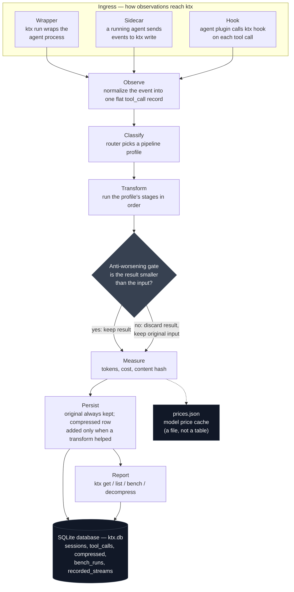

# ktx Architecture

Aspirational architecture for ktx. This document describes **what the system is for** and **how its parts relate at a conceptual level**. It does not commit to implementation choices. Those are captured as open deliberations at the end; resolving them is what will refine this document over time.

For product direction, see `.agentera/vision.yaml`. For recorded choices already made in deliberation, see `.agentera/decisions.yaml`. For agent workflow and document maintenance, see `AGENTS.md`.

---

## Purpose

ktx is a single, runtime-agnostic command-line layer that coding agents can adopt without importing a library or running a background service. It exists to make agent work **measurable** and **cheaper**: every meaningful interaction leaves evidence, and compression reduces what reaches the model without hiding the cost of doing so.

The architecture serves two audiences at once:

- **The agent runtime** — transparent interception, minimal friction, predictable behavior.
- **The agent-native developer** — inspectable records, reversible compression, and a benchmark number that can be cited and disputed.

Compression is the demonstrator. Measurement is the contract. The benchmark is the headline.

---

## Architectural goals

| Goal                                  | Meaning                                                                                                            |
| ------------------------------------- | ------------------------------------------------------------------------------------------------------------------ |
| **Invisible until needed**            | Normal agent workflows proceed unchanged; value appears in summaries, queries, and benchmarks—not in ceremony.     |
| **Evidence over claims**              | Savings and cost are derived from stored observations, not from marketing or one-off demos.                        |
| **Reversibility before aggression**   | Compression may be strong only where originals can be recovered on demand.                                         |
| **Stable surface, evolving dispatch** | The user-facing CLI stays boring and stable; what happens behind the router can improve without breaking adoption. |
| **One artifact**                      | A single binary the runtime invokes—no daemon requirement, no library coupling.                                    |

---

## Conceptual system

At the highest level, ktx is a loop:

```text
observe → classify → transform → measure → persist → report
```

Every adoption path feeds this same loop. An observation (one tool call and its output) enters at the top; evidence comes out at the bottom:



Two steps in the loop have internal structure worth seeing on their own. Classify and transform work like this:

```mermaid
flowchart LR
  subgraph layers["Five layers — kinds of context waste<br/>(taxonomy the router classifies by; not code modules)"]
    L1["L1 Shell — command stdout and stderr"]
    L2["L2 Tool — large tool and MCP payloads"]
    L3["L3 Code — file reads, diffs, dumps"]
    L4["L4 Instructions — rules, skills, agent docs"]
    L5["L5 Memory — history, cross-session carry"]
  end

  C["Router<br/>classifies content,<br/>selects one profile"]

  subgraph profiles["Profiles — named stage lists in ktx.toml"]
    P0["pipeline.default<br/>passthrough when no ktx.toml exists"]
    PX["pipeline.shell / tool / code /<br/>instructions / session<br/>(content-type routing planned;<br/>command-aware routing active for L1)"]
  end

  subgraph stages["Stages — bytes in, bytes out, error or nil"]
    B["Built-in Go stages<br/>strip-ansi, dedup-blank, normalize,<br/>head, truncate, keep-ends,<br/>grep, grep-v, token-budget"]
    U["User plugins — ktx.toml plugin blocks<br/>subprocess: stdin in, stdout out<br/>same name shadows a built-in<br/>(last writer wins)"]
  end

  layers -.-> C
  C --> profiles
  profiles --> stages

  classDef planned fill:#374151,color:#f9fafb,stroke:#4b5563
  class PX planned
```



### Grammar

The diagrams above use five nouns that build on each other. In order from outermost to innermost:

| Term        | What it is                                                                                                                                                                                                                                                                                                                                                                       | Examples                                                                                                                                                          | Where it lives                                                                               |
| ----------- | -------------------------------------------------------------------------------------------------------------------------------------------------------------------------------------------------------------------------------------------------------------------------------------------------------------------------------------------------------------------------------- | ----------------------------------------------------------------------------------------------------------------------------------------------------------------- | -------------------------------------------------------------------------------------------- |
| **Ingress** | An adoption mode: how ktx receives observations from an agent. Ingress variants converge on the same internal loop; the choice only changes _where_ observation begins.                                                                                                                                                                                                          | Wrapper (`ktx run`), Sidecar (`ktx write`), Hooks (`ktx init opencode` + `ktx hook`)                                                                              | Agent runtime + ktx CLI                                                                      |
| **Layer**   | A category of agent context where waste appears. Layers are the _inputs_ to classification — they describe what the router sees, not separate code modules.                                                                                                                                                                                                                      | L1 Shell (command output), L2 Tool (MCP payloads), L3 Code (file reads, diffs), L4 Instructions (rules, skills), L5 Session+memory (history, cross-session carry) | Conceptual taxonomy only; no layer field exists in the record today                          |
| **Profile** | A named, ordered list of stage tokens that the runner executes. Profiles are selected by the router at classify time. Today `default` runs and command-aware routing (tool name, command prefix, exit status) selects among named profiles for Layer 1; per-layer content-type profiles (`[pipeline.shell]`, `[pipeline.tool]`, etc.) remain aspirational.                       | `[pipeline.default] stages = ["strip-ansi", "head:100"]`                                                                                                          | `ktx.toml` `[pipeline.<name>].stages`; inspectable via `ktx config show --json`              |
| **Stage**   | A single bytes-in → bytes-out → error-or-nil transform. Stages are the atoms a profile is built from. The runner enforces the conservative-on-failure contract around every stage; stage authors cannot violate it. Built-in Go stages and external subprocess stages share the same `Stage` interface.                                                                          | `strip-ansi` (no arg), `head:100` (arg = line count), `token-budget:2000`, `grep:^error:`                                                                         | Go package `internal/pipeline/stages`; also any command addressable via a `[[plugin]]` block |
| **Plugin**  | A user-registered external stage: a shell command ktx spawns with input on stdin and output on stdout. Plugins are registered after built-ins, so a plugin named `head` shadows the built-in `head` (last-writer-wins); removing the block restores the built-in. A plugin is just another stage from the runner's perspective — the only difference is _how it got registered_. | `[[plugin]] name="myf", command="/usr/local/bin/myf", description="custom filter"`                                                                                | `ktx.toml` `[[plugin]]` blocks; managed via `ktx plugin add/list/remove`                     |

**How they relate:** An **ingress** path delivers a tool_call to ktx. The router **classifies** it (conceptually by **layer**, in practice by profile selection) and picks a **profile**. The profile is an ordered list of **stage** tokens; each stage (built-in or **plugin**) transforms bytes. The pipeline result passes the anti-worsening gate, then is measured and persisted. None of these nouns know about each other's internals — ingress is layer-agnostic, layers are not a code module, profiles name stages by token, and plugins are just stages registered from ktx.toml.

**Observe** — Capture what the agent (or its tools) produced: command output, tool payloads, file reads, static instructions, session history.

**Classify** — Decide which kind of content is being handled so the right compression strategy applies. The router wins; individual algorithms are interchangeable behind it.

**Transform** — Apply compression (and optional memory-oriented distillation) through built-in behavior, user configuration, or both. Failure is conservative: a stage that errors, produces empty output from non-empty input, or is unknown passes its input through unchanged. After all stages run, the anti-worsening gate discards the whole result unless it is smaller than the input.

**Measure** — Attach quantitative evidence: tokens in, tokens out, cost, integrity fingerprints. Numbers, not adjectives.

**Persist** — Write per-interaction and per-session evidence; records are queryable later via the database. Originals are append-only and never deleted; compressed artifacts are separate rows that point back to their source by id.

**Report** — Surface run summaries, inspection queries, and aggregated benchmark results—including the headline number that proves savings.

The loop is the system; adoption mode only changes _where_ observation begins.

Default database file: `$XDG_DATA_HOME/ktx/ktx.db`. Path precedence: `ktx db --path <file>` flag > `KTX_DB` env var > default (Decision 8 revised).

---

## Integration topology

Agents differ in how they can host external tooling. ktx accommodates multiple adoption paths that converge on the same internal loop and the same database:

| Mode        | Role                                                                                                                                                                              |
| ----------- | --------------------------------------------------------------------------------------------------------------------------------------------------------------------------------- |
| **Wrapper** | ktx launches or wraps the agent process; observation starts at invocation. Suited to non-interactive and pipe-friendly workflows. Agent output to the caller remains transparent. |
| **Sidecar** | An already-running agent sends events to ktx; observation starts when data arrives. Suited to richer runtimes and custom integrations.                                            |
| **Hooks**   | ktx is wired into the agent's configuration; observation runs silently inside long-lived sessions (including TUIs). Suited where wrapping the process is impractical.             |

All ingress modes converge on one persisted identity contract. KTX owns every
stored identifier; runtime-provided identifiers are correlation inputs, not
database identities. When a runtime supplies a usable runtime name, session
identifier, and tool-call identifier, KTX derives the same canonical identifier
from that tuple on every machine. Events without a complete usable tuple receive
a fresh canonical identifier. Runtime-shaped identifiers and compatibility
aliases are not retained.

Architecturally, these are **ingress variants**, not separate products. Inspection, compression, reversibility, and benchmarking must not depend on which path recorded the data.

---

## The five compression layers

Context waste appears at different stages of an agent session. ktx aims to address all of them through one dispatch model—not five separate tools.

| Layer                | What it targets                                      | Architectural intent                                                                                           |
| -------------------- | ---------------------------------------------------- | -------------------------------------------------------------------------------------------------------------- |
| **1 — Shell**        | Command-line stdout and stderr                       | Filter noise before tool results enter context. Highest volume, lowest semantic risk when done conservatively. |
| **2 — Tool**         | Large structured tool and MCP payloads               | Compact or sandbox bulky results; retrieve detail only when the agent asks.                                    |
| **3 — Code**         | File reads, diffs, exploration dumps                 | Prefer outlines and targeted excerpts over full-file dumps.                                                    |
| **4 — Instructions** | Always-on project memory (rules, skills, agent docs) | Shrink static context loaded every session without dropping safety-critical constraints.                       |
| **5 — Memory**       | Conversation history and cross-session carry         | Distill what persists across turns and sessions so compression compounds over time.                            |

Each layer maps to a **pipeline profile** selected by classification—not to a separate binary or long-running service. Built-in behavior provides defaults; user extension refines or replaces stages without forking the CLI surface.

Memory is not a separate product feature; it is how compression **sticks** across sessions. Layer 5 closes the loop Layer 1–4 open.

---

## Core components (conceptual)

These are logical roles, not implementation modules. Names may change as deliberation proceeds.

### Ingress

Accepts observations from wrapper, sidecar, or hook paths. Normalizes them into a common internal representation before classification.

### Router

Inspects incoming bytes (or metadata about them) and selects a pipeline profile. This is the deliberate center of gravity: ktx optimizes for **correct dispatch**, not for owning the best compression algorithm in every category.

### Pipeline

Executes an ordered sequence of transformation stages—built-in, configured, or external—producing compressed output and failure semantics when a stage cannot run safely.

### Reversibility

Retains originals (or sufficient material to reconstruct them) keyed for retrieval on demand. Enables aggressive compression elsewhere without silent loss.

### Persistence

Writes session-scoped and call-scoped records to the database: inputs, outputs, metrics, and references into the reversibility layer. Exposed as mechanical I/O (`read` / `write`) and higher-level query (`get` / `list`).

### Measurement

Computes or ingests token and cost figures in a form that can be audited and reconstructed. Feeds both per-call records and benchmark aggregation.

### Benchmark

Aggregates persisted evidence into comparable headline metrics—cost per correct answer, savings over baseline, and related reports—using a published methodology. The Go experiment module owns tasks, scoring, retained manifests and attempts, deterministic summaries, live comparison, and ranking. SQLite remains product evidence; experiment-side assignment and orchestration metadata remain file artifacts outside the database.

### Extension registry

A discoverable set of user-supplied behaviors that pipelines can invoke. Distinct from hook installation (which wires ktx into an agent runtime) and from persistence (which holds evidence).

---

## I/O and query separation

Architecturally, ktx distinguishes **mechanical I/O** from **derived inspection**:

- **I/O** (`read`, `write`) moves records faithfully—raw, structured, suitable for pipelines and audits. Always raw JSON; no output-format flag.
- **Query** (`get`, `list`, `bench`) aggregates, filters, and formats for humans or downstream tools. JSON by default; `--format text` for humans.

Compression produces new records from existing ones; decompression recovers prior bytes through the public surface. Benchmark reads from the same evidence as inspection: no parallel truth.

---

## Quality attributes

| Attribute                | Target behavior                                                                                                                                                       |
| ------------------------ | --------------------------------------------------------------------------------------------------------------------------------------------------------------------- |
| **Transparency**         | Wrapped agents behave like unwrapped agents from the caller's perspective; side effects of measurement stay out of the agent's primary I/O where silence is required. |
| **Conservative failure** | When compression cannot run safely, pass through unchanged and record that fact—never substitute guessed content.                                                     |
| **Empirical default**    | Machine-readable output is the default; human-readable views are opt-in. Exit codes encode outcome class.                                                             |
| **Local-first**          | Evidence and reversibility material remain under the developer's control on disk; no required cloud account for core operation.                                       |
| **Boring extension**     | Prefer universal, inspectable extension mechanisms over embedded domain-specific languages or opaque magic.                                                           |

---

## Resolved tension (intentional)

ktx will not win every compression benchmark against specialized tools. It wins by **dispatching** the right strategy per layer, **recording** what happened, and **proving** savings and cost in a form others can cite.

The CLI surface stays narrow. The space behind the router stays wide.

---

## Open deliberations

The items below are **not** architecture yet. They are questions for future resonera sessions. PoC/MVP blockers are cross-linked in [`TODO.md`](TODO.md). When an item is resolved, follow [AGENTS.md — Documentation maintenance](AGENTS.md#documentation-maintenance).

### Ingress and session lifecycle

- [ ] Whether a foreground proxy mode belongs in the architecture (wire-level compression) without violating the no-daemon principle.

### Record model and persistence

- [ ] How session roll-up counters relate to append-only call evidence for benchmark aggregation.
- [ ] Retention, compaction, and pruning policy for originals versus compressed artifacts.

### Router and classification

- [ ] Taxonomy of content types the router recognizes and the order of fallback when classification is ambiguous.
- [ ] How layer (shell, tool, code, instructions, session) maps to router profiles—one-to-one or many-to-one.
- [ ] Signals available at ingress beyond raw bytes (command name, tool name, MIME hints, agent metadata).

### Pipeline and compression

- [ ] Pipeline stage contract: the full stage interface (metadata, ordering guarantees, terminal-vs-continuable stages) beyond the decided runner-level bytes-in/bytes-out/error-or-nil contract.

### Memory and layer 5

- [ ] Operational definition of the memory stage: sync versus async, inline versus on session close.
- [ ] What gets distilled, where it is stored, and how the next session consumes it.
- [ ] Boundary between session-history compression and cross-session memory—same pipeline or separate profiles.
- [ ] Optional external distillation tools: allowed roles without violating boring-before-clever constraints.

### Measurement and benchmark

- [ ] How per-layer savings roll into session and benchmark headline numbers without double-counting.

### CLI surface and ergonomics

- [ ] Extended diagnostics scope: `ktx doctor --fix` for orphaned session reconciliation (Decision 1 revised), `ktx db --prune` for cleanup, pipeline sanity checks. Basic scope settled per Decision 2; non-blocking.

### Security and trust

- [ ] Threat model for executing user-configured pipeline stages (shell, scripts, plugins).
- [ ] Redaction requirements for secrets in originals and compressed output.
- [ ] Integrity and audit expectations beyond per-record content fingerprints.

---

## Document maintenance

See [AGENTS.md — Documentation maintenance](AGENTS.md#documentation-maintenance).

Until deliberations are resolved, treat this file as the map of intent—not the blueprint.
